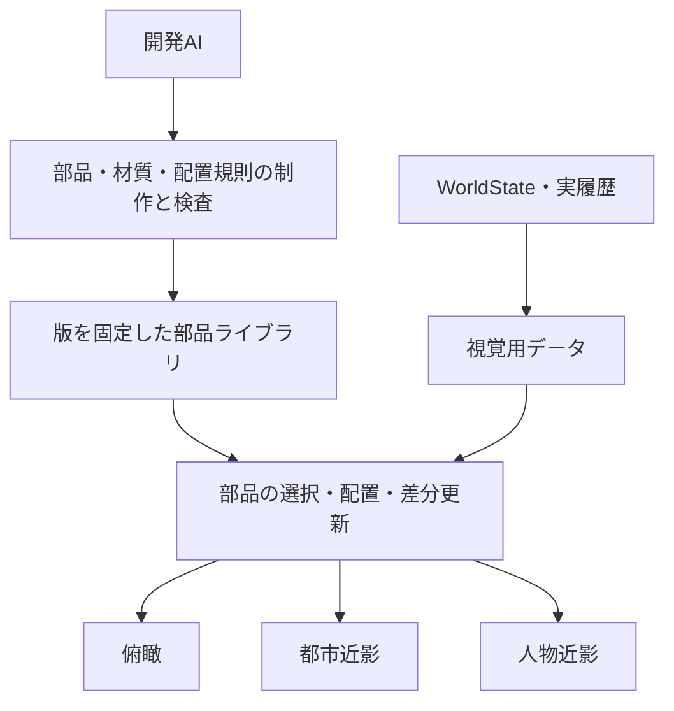

# Chronofork 視覚生成システムの要件・技術調査

更新日: 2026-11-19  
状態: **固定俯瞰の観察方針・都市表現の重点・3Dを第一比較候補にする方針はユーザー採用（DEC-175/176、出典PR #137）／最終描画方式・個別ツール・グラフィックMVPは未確定**  
確認した正本: `main` `5dd99cc208fa661c15fb76216d4d71d8d3fe528f`

## 1. この資料の役割と今回の修正

この資料は、完成形のChronoforkに必要な視覚生成を検討するための領域資料である。ゲーム全体のMVP『亡国の王冠』の既存実装範囲を、そのままグラフィックの最終要件にしない。完成形の要件を先に整理し、重要な不確実性を検証できるグラフィック側のMVPを後から切り出す。

2026-11-19のユーザー指示により、先行調査の「現在のゲームMVPに必要な固定素材を中心に候補を選ぶ」という検討順序を置き換える。以前のツール調査は参考にできるが、MVPへの即時適合だけで最終的な表現・技術候補を除外しない。

### 確定度の区別

| 区分 | 内容 | 扱い |
|---|---|---|
| 今回の明示的な作業指示 | 完成形を起点に要件を再整理し、その後にグラフィックのMVPを決める。開発コンテクストを保存し、技術調査をやり直す | 本調査の進め方として適用 |
| ユーザーが示した最終方向 | 多数の変数で世界線をシミュレーションするゲームに、視覚的な自動生成も組み込みたい。俯瞰・都市近影・人物近影等を生成し、そのためのグラフィックパーツをAIに作成させたい | 要件検討の与件。全機能の即時実装承認ではない |
| 先行して示された制作運用 | ChatGPT等のAIから生成・ローカル修正までつなぎ、人間が最終成果物を確認する。Blenderの利用を検討している | 制作工程の目標。Blenderの正式採用や完全ローカル推論の確定とは扱わない |
| 今回採用された観察方針 | A「固定方向の世界をスクロール・拡縮して観察する」を基準に検討。世界俯瞰を採用する場合の固定角度・平行移動・ズーム、非要求の範囲、イベント演出を有力候補として検討する方針 | [DEC-175](../decisions/adopted-decisions.md)。世界俯瞰自体・次元数・エンジンの採用まで含めない |
| 今回追加された要件・比較優先順位 | 都市のまとまり・繁栄・文明的特徴を読む。個々の建物の屋根・窓・損傷の精密表示は要求しない。歴史比較を開発序盤から重視し、景観鑑賞も努力目標として両立させる。本人の学習負荷に加えAIの再生成・追加修正・結果確認を重視し、3Dを第一比較候補にする | [DEC-176](../decisions/adopted-decisions.md)。最終3D・Blender・エンジンの採用とは分ける |
| この資料の設計提案 | 視覚用データ、部品規格、安定ID、差分更新、候補ツール、グラフィックMVP、評価方法 | アシスタント提案。採用・実装済みではない |
| 継続して未決 | 最終画風、2D／2.5D／3Dの表示方式、投影方式・近影のカメラ、エンジン、対応機器、許容待ち時間、費用、ライセンス、具体的な文明・文化規則 | 比較と小規模検証で判断。既存仕様へ自動反映しない |

既存の上位体験方針と構想は[体験ビジョン・UI構想](experience-and-ui-ideas.md)を参照する。時代への没入、注目外の変化の発見、事実に基づく歴史比較との整合を重視する。

2026-11-19にユーザーから提供された別チャットの記録を照合し、[美術制作方針のPR #136](https://github.com/squne121/chronofork/pull/136)と内容を統合して検討する。同PRは調査時点では未統合だった。現在は #146 で DEC-173/174 を main に統合済みであり、決定本文は決定記録を参照する。仮アート5原則（世界の重さ、読みやすさ、抑制した色彩、情報の主役、UIとの一貫性）、特定の地球年代へ固定しないこと、Gemini Chatをコンセプトアート等の画像生成で優先する方針、用途別ツール・API/MCP優先を引き継ぐ。今回のClaude CodeとChatGPTの継続利用は、Gemini Chatの画像生成優先を撤回する意味にはしない。最終絵柄は未確定で、過去のB方向への相対的支持も最終採用に拡大しない。

### 世界俯瞰カメラとイベント演出の採用方針（2026-11-19）

ユーザーは以下の観察・検討方針を「採用」と明示した。[DEC-175](../decisions/adopted-decisions.md)に記録する。世界俯瞰自体や3Dの採用決定には拡大しない。

- A「固定方向の世界をスクロール・拡縮して観察する」方式を基準として検討する。

- 3Dグラフィックの最終採用は確定していない。後続のDEC-176で、3Dを第一比較候補にすることはユーザーが採用した。
- 世界俯瞰視点を採用する場合、カメラ角度を固定し、平行移動とズームを提供する。透視投影での実際のカメラ移動の必要性は別途判断する。
- 建物の裏側を見る操作や、人の営みを常時アニメーションで表現することは要求しない。
- 戦争・火災・天災などのイベント演出は、有力候補として検討する。必須化・個別の演出方式は未決。
- この条件から、都市近影・人物近影の投影方式、画角、遷移まで自動的に確定しない。

**技術整理（提案）:** 固定角度の俯瞰、画面の平行移動、拡大縮小、イベント演出は、2D部品合成でも成立する。GodotのCamera2Dはスクロールとzoomを提供し、2Dパーティクルには炎・煙・爆発等の表現がある [T26](https://docs.godotengine.org/en/stable/classes/class_camera2d.html)[T27](https://docs.godotengine.org/en/stable/tutorials/2d/particle_systems_2d.html)。

採用されたAでは画面上の拡縮を基準に検討し、透視投影カメラを空間内で移動させる必要性は別途判断する。正投影ではカメラからの距離で見かけの大きさが変わらず、表示範囲・zoomを変更して拡縮する [T28](https://threejs.org/docs/pages/OrthographicCamera.html)。透視投影でカメラを実際に移動すると、角度を固定しても奥行きに応じた相対位置・倍率・見える面が変わり得るため、単一の2D画像の平行移動・拡縮とは一致しない。透視投影そのものの採用は未決である。

**比較方針:** DEC-176により3Dを第一比較候補にする。具体的な最初の比較順序は§5.8–5.9を参照する。2D／2.5Dの部品合成、Blender等で3D制作して固定方向の2D素材を書き出す方式も選択肢として保持する。制作に3Dを使うこと、地形等に高さデータを持つこと、実行時に3D描画することは別々に判断する。

### 2026-11-20：都市グラフィックMVPの仮採用とUXからの再評価

出典：[PR #137 の2026-11-20判断記録](https://github.com/squne121/chronofork/pull/137#issuecomment-7038863203)。後続のユーザー明示判断を検討経緯として保存する。

- **仮採用（正式採用ではない）:** 都市グラフィックMVPの暫定技術候補として、固定カメラの stylized 3D 都市俯瞰、Three.js を表示・配置・差分制御の中心、Blender を建物・橋・城門などの再利用アセット制作に用いる案。
- **支持・検討中:** グラフィックの制作方法だけでなく、原史の観測、調査、介入、再計算・比較、予想外の変化の発見というプレイヤー体験から、地図／都市俯瞰が担う役割、情報・操作・表示面積・閲覧動機を再評価したい。
- **未承認の提案:** 年表中心＋必要時地図、年表と地図の併置、地図中心を小さなワイヤーフレーム・実データで比較し、調査の自発性、根拠への到達、差分理解を本人試遊で評価する。必要性の確認できたビュー・情報表現からグラフィックMVPを切り出し、必要なら2D／2.5Dも再比較する。

実験は [Issue #138](https://github.com/squne121/chronofork/issues/138)／[PR #139](https://github.com/squne121/chronofork/pull/139)、[Issue #140](https://github.com/squne121/chronofork/issues/140)／[PR #141](https://github.com/squne121/chronofork/pull/141) の既存記録を参照する。本人試遊の初回UIについては Issue #114 を参照。世界俯瞰自体、製品の最終UI、3D必須化、個別エンジン・画風の確定、追加実装許可・実験PRの統合を意味しない。DEC-175/176 の承認範囲を拡大しない。

## 2. 完成形で必要なのは「世界状態を描くシステム」

固定の都市絵・人物絵を有限枚数用意するだけでは、多数の世界線、年代、個体、状態の組合せを扱えない。完成形では、世界の状態から意味のある視覚データを導き、共通の部品と配置規則で場面を作る仕組みが必要になる。

### 追加要件の統合：都市のまとまりと歴史の読み取り

| 項目 | 統合した要求・方向性 | 確定度と範囲 |
|---|---|---|
| 都市の情報粒度 | 都市のまとまり、どの程度栄えているか、どのような文明・文化かを概要として見分ける | 今回の要求。都市を読むための情報を優先する |
| 非要求の細部 | 個々の建物の屋根・窓・損傷まで精密に見せることは要求しない | 今回検討する俯瞰・都市概要の粒度。人物近影の詳細度まで制限しない |
| 地理的な個性 | 斜面・崖・橋・高台等が都市の特徴として分かる | 立地の表現要求。全都市に同じ地形・橋を置く要件ではない |
| 文化ごとの形 | 建物の高さ・幅・街区形状を変え、文化ごとの特徴を出したい | ユーザーが支持した検討方向。具体的な生成変数・分類・対応規則は未決 |
| 行政単位の識別 | 国等の区別をゲーム上分かりやすくする。テーマカラーも候補 | 識別を目指す方向性。配色・対象行政階層・表示場所は未確定 |
| 歴史比較 | 時点・世界線の違いを理解する道具としての役割を、グラフィック開発の序盤から確保する | 採用された優先方針 |
| 景観鑑賞 | 歴史比較と両立させる。風景として鑑賞したくなることを努力目標とする | 不採用・不要という意味ではなく、初期の優先順位を区別する |
| 制作・運用 | 本人の学習負荷、AIが安定して作り直せること、追加・修正の負担、結果の確認しやすさを評価する | 採用された評価方針 |
| 比較順序 | 3Dを第一比較候補にする | 採用。最終表示方式・個別ツールは未採用 |
| 利用するAI | Claude Codeを引き続き利用し、ChatGPTも併用する | 制作体制の与件。具体的な接続・自動実行は導入済みと扱わない |

**情報の分け方（設計提案）:** 地形・都市骨格、文化的な形、繁栄等の状態、行政上の所属を別に扱う。例えば支配国が変わった場合は所属表示を更新し、都市全体や文化的外観を自動的に作り直さない。文化と文明的発展、繁栄と建物の高さを一対一で固定しない。どの状態を何で表すかは、実際のシミュレーションの意味と対応させて検証する。

テーマカラーを試す場合は、旗・紋章・輪郭・選択表示等へ抑えたアクセントとして使う案を優先比較する。これは既存の抑制した色彩方針と両立させるための提案であり、都市の材質を国色で一括上書きする採用決定ではない。色だけで国や状態を判定させず、名称・記号・境界等との併用を検証する。

歴史比較では同じカメラ・光・縮尺を揃え、変わった対象と変わらない対象を確認する。景観鑑賞のための照明変更等は、歴史差分と区別できる見せ方を検討する。今回の粗い表示粒度に合わせ、比較試作の合否へ窓・瓦・微細な損傷の作り込みを追加しない。

ここでの「自動生成」は、次の3工程を含む。

1. **制作時の生成:** AIが部品、材質、バリエーション、配置規則、制作スクリプトを作り、検査して登録する。
2. **ゲーム実行時の生成:** 世界状態に合わせて登録済みの部品を選択・組み立て・描画する。
3. **必要時の追加生成:** 足りない部品や景観を非同期で生成し、検査後に保存・再利用する。完成形の拡張候補であり、毎回の閲覧に外部AI呼出しを必須化しない。

人間が最終確認する運用は、制作した部品、生成規則、代表的な組合せ、ゲーム内での見え方を承認する工程として設計する。発売後に生成される全世界線の全画像を人間が事前承認する運用は成り立たないため、実行時には構造検査と代替表示も必要になる。

### 完成形から導いた要件案

| 要素 | 必要な性質 | 具体的に確かめること |
|---|---|---|
| 世界状態との対応 | 何が存在し、どう変化したかをシミュレーションの事実から導く | 存在しない港・戦災・人物を画像側が事実として追加しない |
| 複数の視点 | 俯瞰・都市近影・人物近影が同じ対象を参照する | 地図の都市・近景の道路や塔・人物の所属先が対応する |
| 個体の同一性 | 同じ都市・建物・人物を再訪して識別できる | 再読込や部品追加だけで顔・都市骨格が変わらない |
| 時間と世界線 | 共通の過去と、分岐後に変わった部分を区別する | 分岐直後の共通部分が一致し、無関係な個体が再抽選されない |
| 変数から見た目への変換 | 直接反映・間接反映・非表示・未定義を明示する | 数値を変えた理由と、変わった表示の根拠を追える |
| 世界の多様性 | 地理、文化、文明段階、産業等に応じた部品と規則を差し替えられる | 特定の湾・川・丘や地球上の単一時代を全都市へ固定しない |
| 部品の互換性 | 寸法、接合、色調、材質、リグ、詳細度を合わせる | AIが別々に作った橋と接続部、服と人体を正常に組み合わせられる |
| 局所的な修正 | 指定部分を変えて他の部分を保てる | 建物群の高さ変更が無関係な道路網、衣装変更が基本顔形状を変えない |
| 再現・保存 | 採用結果、入力、生成器、依存資産の版を追跡する | 過去の世界線を再訪して当時の外観を復元できる |
| 実行時の応答 | 視点・観測対象・状態変化に応じた必要分だけを処理する | LOD、インスタンス描画、差分更新、キャッシュ、生成待ちを評価する |
| 読みやすさと美術 | 世界の変化が読み取れ、全体の画風が揃う | 雰囲気の良さと、歴史比較・調査の分かりやすさを別々に確認する |
| 自動運用 | API／CLI／MCPから実行し、失敗箇所を特定・修正できる | 上限のある再試行、取消、ログ、代替資産、費用計測がある |
| 配布と利用条件 | ツール、モデル、素材、生成物の条件を区別できる | 配布対象と再利用条件を資産単位で確認する。ライセンス方針自体は別途判断 |

「多くの変数」を、そのまま長いプロンプトへ列挙する方式にはしない。どの変数が、どの外観要素へ、どの条件で影響するかを仕様として持つことが重要である。

### 変数と視覚の対応例

以下の値・現象は将来の対応例であり、現在のWorldStateにすべて実装済みという意味ではない。

| 状態・条件の例 | 視覚へ反映する候補 | 保持するもの・注意 |
|---|---|---|
| 人口や都市規模 | 建物密度、地区の広がり、代表的な群衆量 | 人口1人につき1体を描く義務はない。代表表示の密度と実人数を混同しない |
| 建材・技術・文化 | 建物群の高さ・幅、街区形状、建材、衣装 | 文化から身体形状や能力を推定する規則を新設しない |
| 経済的状態・維持状態 | 地区の充実度、設備、建材の更新 | 貧富から無根拠に健康・人格・歴史事実を描き足さない |
| 記録された損傷・再建 | 被災範囲や復旧段階の概要表示 | 戦争があるだけで橋の焼失を創作しない。個別の損傷が未モデル化なら橋の消失や通行不能を示す描写は避け、機能を変えない一般的な風化等の装飾と区別する |
| 年齢・選択済み外観 | 加齢用の形状・材質、髪、服、姿勢 | 同一人物の基本外観を共有。加齢による能力変化や遺伝規則を導入しない |
| 支配・所属の変化 | 根拠のある旗、紋章、制服等 | 所属変更だけで顔や地形を作り替えない |
| シミュレーション上は重要だが不可視の数値 | 図表、注記、状態表示、または表示しない | すべての内部変数に物理的な見た目を捏造しない |

## 3. 推奨する構成案

仮称として、世界状態を描画向けに変換したデータを「視覚用データ」と呼ぶ。新しいゲーム規則の正本ではなく、表示のための投影である。

### 3.1 シミュレーションと装飾の境界

- **事実:** 都市・人物の存在、位置、所属、記録された出来事等。シミュレーション側を参照する。
- **表示上の派生:** 都市規模から導いた代表的建物数、遠景の群衆、未モデル化の窓や小物等。表示用IDと生成規則を保持する。
- **演出:** カメラ、照明、筆致、色調、ポーズ等。比較モードでは条件を揃える。

表示側が補った家屋を、正式な課税対象や歴史イベントの主体としてシミュレーションへ逆輸入しない。後に個々の建物をゲーム上の実体へ昇格する場合は、別の規則・データ設計になる。

人物近影も、都市内の全群衆と1対1対応させる必要があるかは未決。少なくとも選択中の人物とその近影は同じ人物IDを参照する。

### 3.2 同一性と時間変化

- 基本外観は、安定した個体ID・初期外観値・部品参照で管理する。
- 世界線IDや現在年を全外観の乱数seedに直接混ぜない。共通の過去を持つ個体は基本外観を共有する。
- 初めて観測・詳細生成する順序によって基本外観を変えない。分岐前には未表示だった共通個体も、各世界線で同じ基本外観を参照し、分岐後の状態差だけを反映する。
- 新規に生じた個体のID・分岐との対応はゲーム側の規則に従う。存在しない個体対応を見た目の類似だけで推定しない。
- 配列の順番や一つの大域的な乱数列へ依存しない。顔、髪、建物配置、小物等は目的別に乱数・参照を分ける。
- 都市を各年に無関係に作り直さず、道路・区画・建物の継続を扱う。必要なら視覚用の建設・更新履歴を保存し、スナップショットとの関係を定義する。
- 生成器・部品カタログ・モデルの版を固定する。更新後に既存世界を移行するか、以前の版で再生するかを選べるようにする。

意味的な再現性と、ピクセル単位で完全一致する再描画は別の要件である。描画環境が異なっても同じ個体・配置・材質選択を維持することを先に確認する。画像の完全一致が必要な用途では、レンダー環境の固定または採用画像の保存を併用する。

### 3.3 ビューの共通性

俯瞰と都市近影は、共通の地理・道路・建物配置を参照する。人物は共通の顔・体型・髪・衣装データを参照する。カメラ変更を、新しい場面の再抽選として扱わない。

距離によって形状や表示量を簡略化するLODは、同じ個体の別表現として管理する。「複数ビューが整合すること」と「地表から顔まで連続ズームできること」は別の要求であり、後者は未確定である。

比較モードでは、カメラ、照明、季節等の演出条件を揃え、実際の状態差と描画条件の差を混同しない。必要に応じて表示条件を変えられる通常観測とは分ける。

### 3.4 実行時と追加生成

高速な描画は、事前制作した部品の選択・配置を中心にする。新しいAI生成が必要な場合は非同期ジョブにし、生成結果・出典・入力・版を保存する。同じ場面の再訪で同じジョブを重複実行しない。

部品選択・配置のキャッシュは、個体ID、視覚的に関係する状態、部品と生成器の版で識別する。レンダー画像のキャッシュには、これにカメラ・照明・解像度等を加える。カメラ変更だけで世界の構造を再生成せず、無関係な変数の変化で全キャッシュを無効化しない。

再試行回数、待ち時間、費用の上限を設定し、失敗時は承認済みの近似部品や簡略表示へ戻す。具体的な数値は対象機器と品質を計測して決める。

## 4. AIに作らせる「部品」の範囲

部品はPNGや3Dモデルだけに限定しない。再利用できる生成器や、部品を組み合わせる規則も含む。

| 分類 | 例 | 共通規格 |
|---|---|---|
| 地形・自然 | 地表材質、岩、植物、水際、地形生成ノード | 単位、座標、密度、植生・地形条件、遠近の表現 |
| 都市骨格 | 道路断面、区画、街区、広場、建物配置ルール | 接続点、通行空間、地形適合、敷地境界 |
| 建築 | 建物の塊、塔、橋、文化を示す特徴部 | 幅・高さ、原点、接合面、用途、年代・様式タグ |
| 人物 | 基本人体、顔パラメータ、髪、衣装、装身具、表情、ポーズ | 骨格、体型範囲、遮蔽、重なり、材質、LOD |
| 表層・演出 | テクスチャ、風化、色差、光、煙等 | 色空間、材質チャンネル、適用条件、比較時の固定条件 |
| 生成規則 | Geometry Nodes、配置グラフ、形状文法、モーフ設定、スクリプト | 入出力、対応版、seed／ID規則、検査、上限、失敗時の動作 |

建築の部位をさらに細分化するのは、必要な見え方や変更単位が判明した場合とする。今回の都市概要のために窓・瓦・微細な損傷の専用部品を必須化しない。

資産の記録には、ID・版・用途・適合条件・出典・利用条件・生成レシピ・検査結果を持たせる。多数の独立した管理文書を作るのではなく、実際に組立と検査に使うカタログへ集約する案がよい。

3Dの場合は頂点数だけでなく、マテリアル数、テクスチャ容量、UV、接合、コライダーの要否、書出し後の見え方も検査する。2Dの場合はキャンバス、基準点、方向、透過、前後関係、パレットを検査する。見た目の改善で他の部品との互換性を失わないことが重要である。

## 5. 技術調査と候補の役割

以下は2026-11-19に公式ドキュメント・作者のリポジトリを確認した結果である。**公開機能の確認と、Chronofork環境での動作・速度・品質の検証を区別する。後者はすべてUNVERIFIED。**

### 5.1 優先比較する構成要素

| 候補 | AIとの接続と役割 | 制作時／実行時・実行場所 | 評価・制約 |
|---|---|---|---|
| **Blender＋Geometry Nodes／Python** | 形状・配置・材質・レンダー・出力をスクリプト化。Blender LabのMCPも公開 [T1](https://docs.blender.org/api/5.1/info_tips_and_tricks.html)[T2](https://www.blender.org/lab/mcp-server/) | ローカルの部品制作、規則制作、バッチ描画 | **制作基盤の第一候補。** 保存済みシーンから複数視点を出せる。Geometry Nodesを他エンジンへそのまま移植できる前提にはしない |
| **MPFB＋MPFB MCP** | 人体、モーフ、衣装、リグ、表情、ポーズ、プリセット、出力を定義済みツールで操作 [T3](https://github.com/makehumancommunity/mpfb-mcp) | Blender上での人物制作・バッチ生成 | **人物の第一比較候補。** MakeHuman Community配布。MCPはEarly beta・42ツール。品質と互換性は要検証 |
| **ComfyUI＋Krita AI Diffusion** | ワークフローによる画像生成・編集、参照画像、材質や衣装差分、レイヤー／マスク編集 [T4](https://github.com/Comfy-Org/workflow_templates)[T5](https://github.com/Acly/krita-ai-diffusion) | モデルによりローカル／外部。制作時中心、必要時非同期にも利用可能 | 部品と表層を作る担当。Kritaプラグインは編集統合であり、無人品質保証そのものではない |
| **Hunyuan3D-2.1** | 画像から3D形状とPBR材質を作るコード・モデル [T6](https://github.com/Tencent-Hunyuan/Hunyuan3D-2.1) | ローカル／GPUサーバーでの候補部品生成 | 屋根・小物等の候補制作。生成結果が規格適合・最適化・リグ済みとは扱わず、Blender側で検査・調整する |
| **Unreal PCG＋Unreal MCP** | 実行時の手続き生成、階層グリッド、編集時のAIによる生成グラフ操作 [T7](https://dev.epicgames.com/documentation/unreal-engine/using-pcg-generation-modes-in-unreal-engine)[T8](https://dev.epicgames.com/documentation/unreal-engine/working-with-pcg-and-llms-using-unreal-mcp-in-unreal-engine) | ゲーム実行時のPCGと、開発時のMCPを分離 | 動的3D世界の有力候補。MCP／LLM機能はExperimental。WorldState変換と履歴保存は独自実装 |
| **Three.js／Godot** | コードからシーン、メッシュ、部品配置、インスタンス描画を扱う [T9](https://threejs.org/docs/pages/InstancedMesh.html)[T10](https://docs.godotengine.org/en/stable/tutorials/3d/procedural_geometry/index.html) | ブラウザまたはゲームアプリで実行時描画 | 部品を状態から組み立てる軽量な試作候補。生成規則・履歴・ツール連携は開発が必要 |
| **Spine Runtime Skins** | 2D人物の髪・衣装等をプログラムで合成 [T11](https://en.esotericsoftware.com/spine-runtime-skins) | 部品制作後、実行時に合成・アニメーション | 2D人物を選ぶ場合に有用。任意の角度へ回れる3D人物の代替とは限らない |
| **MetaHuman Collection／Instance** | 事前構築したCollectionから髪・衣装等を選んで人物を組立 [T12](https://dev.epicgames.com/documentation/metahuman/metahuman-instances-in-unreal-engine) | UEのcooked build内でruntime assembly可能 | 高精細3D人物の比較候補。確認資料ではExperimental。任意の顔を実行時に自由生成できる意味ではない |

### 5.2 拡張・研究の比較対象

| 候補 | 利用する価値 | 境界 |
|---|---|---|
| **Houdini／Houdini Engine** | 高度な地形・建築生成器をHDAとして制作・利用 [T13](https://www.sidefx.com/products/houdini-engine/plug-ins/unreal-plug-in/) | 公式Unrealプラグインはランタイム用ではない。制作時の生成器として比較 |
| **Infinigen** | Blenderベースの自然物・材質・部品生成コード [T14](https://github.com/princeton-vl/infinigen/blob/main/docs/source/GeneratingIndividualAssets.md) | 部品生成器の参考。外部出力ではベイクが必要。全シーン出力はUSDCのみ公式対応、アニメーション出力は未検証で、公式サポート外 [T15](https://github.com/princeton-vl/infinigen/blob/main/docs/source/ExportingToExternalFileFormats.md) |
| **OpenUSD** | 共有部品、レイヤー、variants、非破壊override、payload等 [T16](https://openusd.org/release/intro.html) | DCC間の大規模な資産構成に有用。永続GUIDを提供せず、ゲームの個体IDや分岐履歴は別に管理する。初期検証の必須基盤にはしない |
| **World Labs Atlas** | カメラ・深度付き生成、新視点、マスク編集、splats／meshへの工程。公式CLI・Skills・Blender拡張 [T17](https://docs.atlas.worldlabs.ai/skills-and-plugins)[T18](https://docs.atlas.worldlabs.ai/task-overview)[T19](https://docs.atlas.worldlabs.ai/blender) | クラウド推論。景観・背景制作や表現比較の候補。ゲーム変数と個体単位の変更保証は別設計 |
| **HY-World 2.0** | 公開コード・モデルによる世界生成、経路計画、視点拡張、3D出力 [T20](https://github.com/Tencent-Hunyuan/HY-World-2.0/blob/main/hyworld2/worldgen/README.md) | world generationは4 GPU以上推奨、8×H20で検証との記載。個人PCで軽く動く基盤としては勧めない |

生成された画像の別アングルと、同一の3Dモデルを別カメラから描いた画像は、保証できる整合性が異なる。例えばComfyUIのQwen-Image-Edit-2511には多方向生成のJSONテンプレートがあるが、3D Cameraノードを使うだけで共通メッシュによる幾何的一致が保証されるわけではない [T21](https://docs.comfy.org/tutorials/image/qwen/qwen-image-edit-2511)。

### 5.3 比較する制作・表示方式

「2.5D」は一意の実装方式を指さない。固定カメラの3Dをそう呼ぶ場合もあるため、この比較では制作と実行時表示を分ける。以下では、制作と実行時表示を合わせた3経路を比較する。

| 制作・表示経路 | 本資料での呼び方 | 主な資産 | 特徴 |
|---|---|---|---|
| ① 2D制作→2D表示 | 2D部品合成 | 画像・ベクター・タイル・レイヤー | 固定方向の絵として品質を作りやすい。部品の接合、前後順、近景用の細部を管理する |
| ② 3D制作→固定方向の2D表示 | 事前レンダーを使う2.5D | 3D制作元＋レンダー画像・基準点等 | 同じ3D制作元から画像を作れる。3D制作と2D画像化・配置の両工程を運用する |
| ③ 3D制作→固定角度の実行時3D表示 | 固定カメラ3D | メッシュ・材質・配置・カメラ | 形状や材質の変種を組み立てて描画できる。取込、照明、描画負荷の調整が必要 |

立体的な見た目、写実／絵画調などの画風、実行時3Dの有無は別の軸である。3Dを選んでも自由カメラ、日常アニメーション、物理シミュレーション、写実表現を必須にしない。2Dにも等角投影、照明・影・法線マップを使う方式がある [T32](https://docs.godotengine.org/en/stable/tutorials/2d/2d_lights_and_shadows.html)。

世界俯瞰、都市近影、人物近影、年表・関係図・UIは、すべて同じ描画方式に揃える必要はない。共通ID・位置・外観状態を参照し、各ビューの役割に適した方式を選べる。

現行のTypeScript／Reactへ接続する3D比較にはThree.jsが候補になる。GodotやUnrealは独立した実行基盤を選ぶ場合の候補だが、今回エンジン移行を採用するわけではない。

### 5.4 決定の時期（提案）

**現在は比較対象を仮置きし、小さな比較試作の終了時に世界俯瞰を採用する場合の主方式を決める。本格的な素材量産・生成器・描画統合へ入る前を期限とする。** 根拠のない日付や日数ではなく、手戻りが増える工程を決定点にする。

| 段階 | 決めること | 保留できること |
|---|---|---|
| 現在 | 採用済みの固定方向・pan/zoomに加え、最接近時に読ませたいもの、主な配布環境、代表的イベントを比較条件にする | 最終描画方式、詳細なエンジン構成 |
| 小さな比較試作の前 | 比較する2案、共通の素材・入力・評価条件、終了条件 | 本番規模の部品規格・網羅的な文化キット |
| 比較試作の終了時 | 世界俯瞰を採用する場合の主方式、採用理由、残る制約 | 人物近影等の独立した方式、追加演出 |
| 素材量産・本格実装の前 | 出力形式、接合・原点、配置・遮蔽・選択、詳細度、資産配信の基準 | 後から追加する品質向上・素材数 |

大量の建築・植生素材、複雑な道路や地形生成器、方式固有のクリック判定・影・画像キャッシュを作り込むほど、方式変更の費用が増える。一方、状態と見た目の対応、安定ID、世界線差分、部品の分類は先に検討できる。

三方式をすべて完成させる必要はない。グラフィックMVP（§7）の前に、方式判断のための小さな比較を置く。方式を決めた後に、3ビュー・実WorldState・保存・歴史差分の縦断へ進む。

### 5.5 流用できる知識・資産・実装（提案）

| 対象 | 流用しやすさ | 保存・分離するもの |
|---|---|---|
| 世界状態と外観の対応、事実と装飾の境界 | 高い | レンダラーから独立した意味データ |
| 永続ID、世界線、保存、部品の版 | 高い | ゲーム上の個体IDと描画オブジェクトの内部番号を区別 |
| 都市の配置、敷地、接合、成長規則 | 比較的高い | 画面ピクセルだけでなく、世界上の位置・範囲・高さを必要な範囲で保持 |
| 色彩、構図、視認性、画風の評価 | 高い | 何が読み取れ、何が混同されたかという観察 |
| AIへの部品依頼、検査、局所修正 | 高い | 共通の品質条件と、形式ごとの機械検査を分離 |
| Blenderの3D制作元・UV・基本材質 | ②と③の間で高い | 編集可能な原本。実行時用の最適化・材質調整は別途必要 |
| 2D原画・スプライト | 一部 | UI、テクスチャ、ビルボード等へ使える。見えていない形状は含まれず、3Dへそのまま可逆変換できない |
| 2Dの描画順・マスク・アトラス | 限定的 | 意図・検査は共有できるが、3Dでは深度等へ実装を置き換える |
| 3D照明・シェーダー、カメラ・選択・描画最適化 | 限定的 | エンジンや表現方式に依存。設計知識とコードの流用を区別 |

GodotはglTFを推奨形式として案内し、Blenderファイルの取込も内部でglTF変換を利用する。制作元と実行側を共通形式で接続する経路はあるが、全材質・生成ノード・影が他環境でも同じ見え方になる保証ではない [T30](https://docs.godotengine.org/en/stable/tutorials/assets_pipeline/importing_3d_scenes/available_formats.html)。

共通化は、入力データ、ID、配置、外観規則、制作元の保存から始める。全レンダラーを交換できる大きな独自基盤を先に作らない。比較で使わなかった実行系を本番で維持する必要もない。

### 5.6 工数・未経験者の学習（調査を踏まえた評価）

工数は、初期環境、部品制作、状態差分の追加、統合、調整・更新、検証、配布運用の合計で考える。次元数だけから日数や倍率は算出できない。

| 工程 | ① 2D部品合成 | ② 3D制作→2D表示 | ③ 固定カメラ3D |
|---|---|---|---|
| 初期の基盤 | 平面のスクロール・合成は小さく始めやすい | 3D制作と2D書出し・合成を接続する | メッシュ、材質、照明、取込、カメラを整える |
| 多様な形・状態 | 差分画像、レイヤー合成、色替え等で管理 | 3D元から変種を作り、必要分を画像化する | 元の形状・材質をパラメータで変え、実行時に組み立てる |
| 高低差・重なり | 描画順、画像分割、マスク等の規約が必要 | 高さや接合に加え、画像の前後関係を管理 | 共通の立体構造を使えるが、地形配置や透明物等の検査は必要 |
| ズーム・大規模表示 | 解像度、切替画像、アトラス、過剰な重ね描きへの対応 | ベイク解像度・画像数・更新範囲も管理 | LOD、インスタンス、材質数、影、テクスチャ容量を調整 |
| 元素材の修正 | 対象レイヤーと整合する差分を更新 | 元の修正後に必要な画像を再出力 | 元の修正後に再取込し、ゲーム側の見え方を確認 |
| AIでの検査 | 透過、輪郭、画風、接合、保持領域 | 左の検査と、3D制作元・書出しの検査 | 寸法、接続、UV、材質、容量と、レンダー結果の検査 |

これは実測順位ではなく、工数が発生する場所の整理である。2Dでも部品合成や色替えで差分数を抑えられる。3Dでも、形状・材質の制約や最適化が自動的に消えるわけではない。②は二つの工程を持つため、必ず①と③の中間コストになるとは限らない。

3DにはLODを自動生成する支援もあるが、形が崩れる場合等の検査が必要である [T31](https://docs.godotengine.org/en/stable/tutorials/3d/mesh_lod.html)。2Dにはライト・影の仕組みもあるため、「2Dは影を付けられない」を選択理由にしない [T32](https://docs.godotengine.org/en/stable/tutorials/2d/2d_lights_and_shadows.html)。

Godotの入門資料は、未経験者に2Dから始める学習順序を勧め、2Dで学んだパターンを3Dで再利用すると説明している [T29](https://docs.godotengine.org/en/stable/getting_started/first_3d_game/index.html)。これは本人が実装を学ぶ入口の参考になる。一方、ChronoforkではAIが主に実装・制作するため、本人の操作習得量だけで本番方式を決めない。AIが作業する時間、修正反復、失敗の特定、本人の確認負担まで評価する。

本人が先に理解すると流用しやすいのは、何を見せたいか、情報の読みやすさ、部品の寸法・接合、局所修正、採用基準である。全ツールに熟練してから比較を始める必要はない。

### 5.7 ゲームへの適合を判断する小さな比較（提案）

今回の追加要件により、俯瞰・都市概要の粒度は、都市のまとまり、繁栄、文明・文化、特徴的な地形を読めることとする。個々の建物の細部は比較の必須条件にしない。実際の画面占有率・ズーム上限、対象機器、目標画風はまだ具体化が必要である。世界俯瞰が常に主画面か、都市近影が独立画面かも区別し、必要のない連続ズームを追加しない。

最初の試作は、3Dを第一候補にするDEC-176と§5.8–5.9の具体化案に従う。3Dと2D出力を比較する必要が生じた場合は、同じ小さな部品を使う②「画像化して2D合成」と③「固定カメラで3D描画」で素材の出来による差を抑える。絵画調・図像的な2Dを検討する場合は①も比較対象に残す。②／③だけの比較で①全体を評価したことにはしない。

比較は同じ配置、固定角度、解像度、ズーム範囲、色調、UI、状態変更で行う。完成した2D絵と未調整の3Dブロックを比べて方式の優劣としない。方式を試すための合成データはexperimentalとする。

| 観察ケース | 判断したいこと |
|---|---|
| 通常の街並みと注目対象 | 都市の特徴・所属・状態を読み取れるか。好みの画風へ近づけられるか |
| 斜面、高い建物、橋等の代表的な重なり | 配置、前後関係、クリック、選択表示が破綻しないか |
| 想定する最大ズーム | 都市の塊・地形・文化的特徴を読め、粗さや詳細切替が体験を妨げないか |
| 建物群の高さ・幅・街区形状、所属表示等の一部変更 | 指定した範囲だけが変わり、無関係な街区・地形・個体が保たれるか。微細な損傷を要求しない |
| 火災等のイベント1種 | 位置、規模、重なり、終了後の状態が分かりやすいか |
| 配置数を増やす | 対象機器でpan/zoom、読込、状態更新、メモリが許容範囲か |
| AIに部品の追加・局所修正を依頼 | 初回成功率、修正反復、人間の確認負担、再出力の範囲を測れるか |
| 別seed・別の配置でも再実行 | 一場面だけに合わせた手調整で成立したものではないか |

**終了条件:** 固定方向の操作、状態・個体の整合、代表的な地形・イベント、必要な応答、再実行可能なAI制作工程を満たす候補から、好みと追加・修正の負担で選ぶ。計測閾値は対象機器・画質・画面規模に合わせて事前に置く。差が付かなければ、判断を妨げる最大の不明点を一つだけ追加検証し、全方式を無期限に並行開発しない。

### 5.8 採用された比較優先順位と具体化案

**3Dを第一比較候補にすることは、2026-11-19にユーザーが採用した（DEC-176）。** 最終的に3Dを採用すること、Blenderを採用すること、特定エンジンへ移行することは未決である。

今回の粒度では、簡素な立体部品と地形から都市を構成し、固定角度で描く案を優先して試す。高さ・幅・街区形状をコードや生成規則で変更できることは、細部を増やすより重要な評価対象になる。これは要件からの設計判断であり、3Dの方が必ず短工期になるという実測結論ではない。

最初に比べる制作経路は§5.9の二つを提案する。同じ少量の都市データからゲーム画面へ出し、再生成・局所修正を比較する。3D表示の負荷や画風が要件に合わなければ、同じ制作元からの2D出力も比較する。全ての制作ツールと三つの次元方式を組み合わせた網羅試作は行わない。

判断手順は、**小さな比較→主方式の決定→グラフィックMVPの縦断→部品数・文化・地域の拡張**を維持する。日常アニメーション・自由カメラ・精密な建物・物理破壊を、3Dに付随する必須要件にしない。

### 5.9 Blenderと代替手段の比較（提案、実機未検証）

汎用の3D制作ソフトを一つ試すならBlenderを第一候補にする。一方、今回の都市概要は単純形状と配置規則でも表せるため、**Claude CodeがThree.js用の生成コードを直接作る方式も強い比較候補**になる。制作ソフト、生成規則、ゲームの表示基盤は別の役割である。

| 候補 | AIからの操作・制作 | 今回の要件との対応 | 優先度と主な負担 |
|---|---|---|---|
| Blender＋Python／Geometry Nodes | Python API、バッチ処理、公式Blender Lab MCP [T1](https://docs.blender.org/api/5.1/info_tips_and_tricks.html)[T2](https://www.blender.org/lab/mcp-server/) | 文化別の部品、地形、橋、生成器、材質、固定カメラ画像を編集可能な原本として保存できる | 汎用制作の第一候補。ゲーム用出力、材質の差、原点・軸・縮尺の検査が必要 |
| Three.js＋TypeScriptの直接生成 | AIが通常のコードとして形・街区・配置・色を実装し、ブラウザで確認。InstancedMesh、GLTFLoaderを利用できる [T9](https://threejs.org/docs/pages/InstancedMesh.html)[T33](https://threejs.org/docs/pages/GLTFLoader.html) | 簡素な都市群、建物高幅、街区、所属表示を既存React/TypeScriptへ接続する候補 | Blender経由と比較する。造形・選択・更新・最適化をコードで設計する負担がある |
| Houdini＋HOM／HDA | Python、hython、外部RPCやコミュニティMCP [T34](https://www.sidefx.com/docs/houdini/hom/commandline.html)[T35](https://github.com/healkeiser/fxhoudinimcp) | 複雑な地形、道路、街区や建築の生成規則を扱う候補 | 形状制約が複雑になった時の比較候補。ノード知識、実行環境とライセンス、出力工程が増える。公式UEプラグインはゲーム実行時の生成器ではない [T13](https://www.sidefx.com/products/houdini-engine/plug-ins/unreal-plug-in/) |
| Godot／Unreal PCG | スクリプト／PCGで配置・表示・演出。制作時MCPも候補 [T7](https://dev.epicgames.com/documentation/unreal-engine/using-pcg-generation-modes-in-unreal-engine)[T8](https://dev.epicgames.com/documentation/unreal-engine/working-with-pcg-and-llms-using-unreal-mcp-in-unreal-engine)[T10](https://docs.godotengine.org/en/stable/tutorials/3d/procedural_geometry/index.html) | 大きな3D実行基盤を選ぶ場合に検討できる | 既存Web構成からの移行を伴い得る別判断。Blenderの単純な代用品として比較しない |
| 画像から3Dを作るモデル | Hunyuan3D等で部品候補を作る [T6](https://github.com/Tencent-Hunyuan/Hunyuan3D-2.1) | 特徴物や素材案の補助 | 個体維持・寸法・接合・局所更新を保証する生成器ではない。都市状態を毎回丸ごと自由生成する用途へ直結させない |

Blenderの公式MCPはアドオンとサーバーを導入する経路であり、Blenderが標準状態でLLMへ接続済みという意味ではない [T2](https://www.blender.org/lab/mcp-server/)。MCPの機能数やSkillの文章量を品質の指標にせず、保存した作り方と結果を再実行・検査できるかで評価する。

**最初の二経路（提案）:**

1. **Blenderで部品・形を制作し、Three.jsで配置・表示する。** Claude CodeがPython等を作り、Blender原本とglTF/GLBを保存する。都市の状態・配置・所属はゲーム側の視覚データで制御する。
2. **Three.jsで部品・形・配置を直接生成する。** Claude CodeがTypeScriptの生成規則を作る。単純な街区と建物群は外部制作ソフトを経由せず、ブラウザで形と状態差を確認する。

両者を併用する形もある。単純な建物群・地形はコード、特徴的な橋やランドマークはBlenderという役割分担でよい。部品の寸法・原点・ID・接合は共有する。Geometry Nodesのグラフ自体がglTFへ移植されるわけではなく、実行時に必要な形状可変性は、パラメータで組む部品・生成コード・準備済み変種のどれで実現するかを確認する。

### 5.10 Claude Code・ChatGPTを使う制作工程（具体化案）

- **ChatGPT:** 要件の整理、参照の比較、AIへ渡す制作仕様、出力の独立レビュー、ユーザー評価の整理を担当する。
- **Claude Code:** ローカルの生成スクリプト、部品、検査、書出し、ゲームへの組込み、修正を担当する。ローカルMCPを接続する経路は公式にある [T46](https://code.claude.com/docs/en/mcp)。この調査でユーザー環境へ導入したわけではない。
- **Gemini Chat:** PR #136の採用方針に沿い、コンセプトアート等の画像生成を優先して依頼する。Claude CodeとChatGPTの継続利用と両立する。
- **人間:** 読みやすさ、文化の差、同じ都市と分かるか、好み、どこまで仕上げるかを判断する。AIの自己採点だけで体験面を合格にしない。

生成器と採用部品を保存し、通常のゲーム表示では、それらを世界状態から組み立てる。AIへの自然言語指示を毎回再実行して同じ都市を作り直すことを、再現性の仕組みにしない。

制作は「入力の明確化→生成・編集→構造検査→固定条件の比較画像→必要な部分の修正→保存」の短い反復で進める。検査は形・接地・橋の接合・ID・変更範囲等の数値検査と、見た目の検査を組み合わせる。複数AIを使う場合も、同じBlenderシーンへ同時に書き込まず、分離した部品かファイルを担当させる。小さな試作から多数の担当・Skillを必須化しない。

部品・生成スクリプト・入力・seed・ツール版・採用画像を一緒に残す。プロジェクト固有の短い手順は、基準寸法、可変項目、触らない範囲、再生成コマンド、検査と停止条件から始める。既存の委任Skillと領域資料を使い、グラフィック固有の進捗や長い制作ノウハウをルートCLAUDE.mdへ積み増さない。

## 6. 実在するワークフロー・配布物

| 公開物 | 確認できた内容 | Chronoforkで参考にする点 | 実証の限界 |
|---|---|---|---|
| **City Sample PCG** [T22](https://dev.epicgames.com/documentation/unreal-engine/city-sample-pcg-for-unreal-engine)[T23](https://www.fab.com/listings/4898e707-7855-404b-af0e-a505ee690e68) | 都市生成PCGグラフ、道路・建物の形状文法、部品組立、Unreal MCPでの開発例を配布 | 境界→道路→街区→敷地→建物を分割し、AIに既存グラフを改修させる方式 | 現代都市の例。PCGデモ自体は交通・歩行者AIなし。標準ではstreaming無効・生成Actor非partitioned。公式例の全体再生成は数分と説明され、フレーム単位の状態更新の実証ではない。歴史シミュレーターではない |
| **Unreal MCPのPCG Skills** [T8](https://dev.epicgames.com/documentation/unreal-engine/working-with-pcg-and-llms-using-unreal-mcp-in-unreal-engine) | `Skill_PCGGraphGeneration`、形状文法・バイオーム等のSkillを公式案内 | プロンプト＋Skillから、繰り返し使う生成規則を作る | Experimental。公開されていることと、最終確認だけで無人量産できることを同一視しない |
| **MPFB MCP** [T3](https://github.com/makehumancommunity/mpfb-mcp) | MakeHuman Communityの実装、人体・衣装・表情等の42ツール、保存・復元・出力 | AIが人物部品とパラメータを操作する具体的接続 | Early beta。対応環境、衣装干渉、最適化、好みへの適合は未検証 |
| **ComfyUI公式テンプレート** [T4](https://github.com/Comfy-Org/workflow_templates)[T21](https://docs.comfy.org/tutorials/image/qwen/qwen-image-edit-2511) | JSONワークフロー、モデル配置、参照付き編集、多方向生成例 | 再利用する生成工程の保存、部品・材質・差分の制作 | ノード・モデルの依存版が必要。テンプレートに歴史整合性は含まれない |
| **World Labs公式Skills** [T17](https://docs.atlas.worldlabs.ai/skills-and-plugins)[T19](https://docs.atlas.worldlabs.ai/blender) | `atlas-flythrough`、`atlas-splats`、`atlas-blender`等。CLI、Blender MCP／background modeの案内 | AIエージェント→生成→Blender上で確認・編集する連携 | クラウドAPIが必要。公式も生成結果を確認して次の文脈に使う手順を案内し、誤差の伝播に注意している [T24](https://docs.atlas.worldlabs.ai/how-to-use-atlas) |
| **Holodeck 2.0** [T25](https://github.com/bzx20/holodeck2.0) | Scene JSON→個別物体画像→Hunyuan3DでGLB→空間制約JSON→配置探索→Blender描画・編集のコード | AI部品生成と配置・描画を分離する実装例 | 研究パイプライン。長期の個体同一性、年代・世界線の保証は対象外。確認時点で再利用ライセンスは未確認 |
| **Infinigen** [T14](https://github.com/princeton-vl/infinigen/blob/main/docs/source/GeneratingIndividualAssets.md)[T15](https://github.com/princeton-vl/infinigen/blob/main/docs/source/ExportingToExternalFileFormats.md) | 手続き生成器、単体部品生成、外部出力のコードと手順 | 自然物・材質・生成レシピの参考 | ゲーム向け最適化や歴史都市の完成システムではない |

### 6.1 英語・中国語・日本語の実践者と配布物（2026-11-19確認）

以下は作者自身の実施記録と配布内容を確認した結果。時間・到達点は作者報告で、Chronofork環境での再現試験や工数見積りではない。公開された説明を読めることと、配布物の動作確認を済ませたことを区別する。

| 言語・発信者 | 取り組みと配布物 | 得られる知識・報告された効果 | 限定 |
|---|---|---|---|
| 日本語・葦沢かもめ（2026-10-05）[T36](https://note.com/ashizawakamome/n/ncdad4a050f36) | ChatGPTの設定と参考画像→Claude Code＋公式Blender MCPで水上都市を制作。解説と修正過程を公開、担当設定5点等はメンバーシップ限定配布 | 部品テンプレート、街区計画、寸法検査、制作と検品の分離、シーン書込み担当の一本化。作者報告では約1日で録画可能な状態 | 照明の修正が長引き、人間が打切り・保留を判断。有料配布物は未取得。ゲーム性能・世界線差分・多seedの安定性は未実証 |
| 日本語・Takeshi Saito（2026-08-12、09-15更新）[T37](https://zenn.dev/fukaunabara/articles/c09ffc9786d413) | Copilot CLIからHoudini/Mayaへ接続。接続入口コードを公開、業務Skill本体は非公開 | GUIへ結果を反映しながら修正することで、以前より確認の反復が速くなったとの報告 | 定量測定なし。ノードエラーのままAIが完了報告、更新モードの原因を見つけられない例もある。Claude Codeでの同じ効果は未検証 |
| 日本語・jyouryuusui（2026-06-28）[T38](https://qiita.com/jyouryuusui/items/82cd109a16f1ae0bc0aa) | 公開fxhoudinimcpを使い、形状・ノイズ・seedを持つ岩生成器と公式ヘルプ参照を試行。MCPコード・導入手順を配布 [T35](https://github.com/healkeiser/fxhoudinimcp) | 単品の完成形でなく、パラメータを変えられる生成器をAIに作らせる例 | 記事内のゼロエラー報告はAIログ。長期運用・都市生成の安定性とは区別する |
| 英語・paraldaMeta、Mirage（試験2026-10-25）[T39](https://github.com/paraldaMeta/mirage-engine/blob/main/examples/agent-trial/TRIAL.md)[T40](https://github.com/paraldaMeta/mirage-engine) | Claude Codeの3担当で海岸・桟橋・灯台を制作し、統合とブラウザ検査を実施。コード、Skills、サンプル、試験記録を公開 | 同じ計画と接合点を共有。数値検査を通った照明問題を一覧画像で発見して修正した | Skillの実施検証は1試行・Claude Codeのみ。エンジン等と一部素材でライセンスが分かれる。READMEの都市作例全てが同梱されるわけではない |
| 英語・Clyrex9 [T41](https://github.com/Clyrex9/building-city-with-claude) | Claude Code＋Blender MCP＋Godot MCP。Blender原本、制作規約、書出し経路、動画と対応コミットを公開 | 寸法・原点・部品規格・描画予算をAIへ渡す方法を追える | 現在は道路と6棟の仮形状、最初のモジュール建物。Godot側は骨組みで、プレイ可能な都市は未完成と明記 |
| 英語・Jacky West、Idea to 3D [T42](https://github.com/jackywest/idea-to-3d) | Claude Code Skill、Three.jsテンプレート、GLB部品、撮影・一覧画像・動画確認を配布 | 部品組立と視野・遮蔽・貫通等の検査を一つの制作工程へまとめる例 | 小さなカートゥーン場面向け。画風、美しさ、歴史整合の保証ではない |
| 中国語・Hailey／lhlGitHub [T43](https://github.com/lhlGitHub/threejs-architecture-effects) | Claude Code等向けthreejs-architecture-effects Skill。Vite＋React＋Three.jsの建築スターター、動画、検証資料を公開 | 立体の建築部品をコードで組み、形を維持した部分修正の指示例がある。組立進行を0〜1で操作 | 一つの建築例。全都市、文明変化、全環境の性能を実証したものではない。作例の地球史様式は採用しない |
| 中国語・bangbuilds、code-doc-film [T44](https://github.com/bangbuilds/code-doc-film) | Claude Code＋Three.jsで歴史題材の3D短編。Skill、JSON、コード、例、確認画像の生成処理を公開 | 作者報告で2分05秒・30場面を55分で制作。公開前に配布ファイルから再構築した記録もある。地形・港湾・街・火煙等が対象 | 制作実績2本、同一macOS環境。ゲームの分岐・リアルタイム性能は未実証。人物近影には不向き |

**効果が出なかった公開例も評価に含める。** NodeCueのblender-node-skillsは英語・中国語READMEとSkillを公開し、2026-10-01にCodex、Blender 5.2.2、公式MCPで50項目の課題を各条件1回試している。作者報告ではSkillなし183秒、全Skillあり273秒で、いずれも50/50だった。詳細Skillは誤りを減らさず、現在は保守終了。エラーにならない値の誤りや見栄えの正否は未解決と明記される [T45](https://github.com/nodecue/blender-node-skills)。これはClaude Code等へ一般化できる統計ではないが、Skill追加を改善と決めつけず、効果を測る必要を示す事例である。

共通して参考になるのは、編集可能な部品・生成コードの保存、構造と画面の両方による検査、範囲を限定した修正である。一方、これらの公開例はChronoforkの都市の同一性・世界線・観測順序を保証する完成パッケージではない。実世界の都市・年代の題材や、公開例の大きなアニメーション範囲を、そのままゲーム要件へ取り込まない。

今回確認した範囲では、「多数の世界線の実状態を正本として、俯瞰・都市・人物の整合性を保証するChronofork用完成パッケージ」は見つかっていない。公開物は部品として組み合わせ、状態変換・永続ID・履歴・検査をChronofork側で実装する必要がある、という調査上の判断である。

公開コードの存在を、採用許可や商用利用可能の確認に置き換えない。本調査ではコードの取り込み、ライセンスの変更、有償サービスの契約は行っていない。

## 7. 完成形から切り出すグラフィックMVP案

### 目的

**少数のAI制作部品から、同じ世界の俯瞰・都市近影・人物近影を生成し、年代と世界線を切り替えても変わるべき部分だけが変わることを確認する。**

この縦断が成立すれば、後から部品数・文化・地域・描画品質を増やす土台になる。一枚の完成絵だけでは、このリスクを検証できない。DEC-176を反映し、都市では概要と歴史差分の読み取りを先に評価し、個々の屋根・窓・損傷の精密表示をMVPの条件へ加えない。景観鑑賞の品質は両立を目指すが、初期の構造・比較検証を無期限に延期する仕上げ条件にはしない。

### 範囲案

- 1つの小地域、1都市、数人の識別できる人物。
- 俯瞰、都市近影、人物近影の3ビュー。連続ズームは必須にしない。
- 同じ起点を共有する2世界線、2〜3時点。
- 建築キット、人物の顔・髪・衣装、地表材質の小さなセット。
- AIが部品または部品生成器を作成し、仕様に従って検査・修正する工程。
- いくつかの明示した状態変化を外観へ反映する。
- 保存・再読込・差分更新・代表的な失敗時の代替表示。
- 調整に使っていない別seed／状態の組合せでも評価する。

上記の数は提案する試験規模であり、正式世界設定・ゲーム規則・完成形の上限ではない。現行のシミュレーションにない変化は `experimental` な視覚テストデータとして扱い、現在のWorldStateが実際に生成した履歴と偽装しない。実WorldStateとの接続も少なくとも一例を必須とし、例えば既存の人物ID、観測年、出生年を読み、同じ人物の年齢に対応した表示へつなぐ。現行の[WorldState型](../../src/simulation/contracts/world.ts)にはこれらの値がある一方、都市の建物配置は定義されていない。未実装の将来変数を使う試験と実WorldStateの統合確認を分け、experimentalだけのデモを統合合格にしない。

### 提案する成果物

1. 共通規格を持つ小さな部品ライブラリと生成レシピ。
2. 世界状態から視覚用データへ変換する最小の処理。
3. 同じ個体・配置を使う3ビュー。少なくとも1つの実行側試作で、保存済みの部品と視覚用データから表示を更新する。Blenderの制作・レンダー工程とゲーム側の表示更新を区別して計測する。
4. 年代・世界線の切替と保存・再読込。
5. 根拠付きの比較画像、検査結果、速度・失敗率・費用の記録。

### 合否の観点

| 観点 | 合格条件として採用する案 |
|---|---|
| 事実の整合 | 表示した実体・変化を入力に追跡でき、装飾による補完を事実へ逆輸入しない。実WorldStateからの接続を一例以上確認する |
| 複数ビュー | 同じ都市の位置・骨格、人物の基本外観が対応する |
| 世界線 | 分岐前の共通部分が一致し、分岐後も無関係な個体・部品は変わらない |
| 時間 | 状態に応じた差分があり、都市全体や顔を毎回再抽選しない |
| 局所修正 | 指定した部品の修正で無関係な部分が変わらない |
| 再現性 | 採用済みの部品参照と視覚状態を保存・復元できる |
| 汎用性 | 調整に使わなかった組合せでも構造検査を満たす。1場面だけの手調整で成功扱いしない |
| 運用 | 自動検査、上限付き再試行、失敗時の代替、ログが機能する |
| 美術・体験 | 都市の塊・繁栄・文明や文化・地形の特徴、個体の同一性と歴史変化をユーザーが読めるかを先に確認する。景観の好ましさも別項目で評価する |
| 性能 | 対象機器・解像度・部品数を記録し、初回／キャッシュ済み、生成／描画を分けて計測する |

性能の合否閾値は、対象機器と最終表示方式を決める際に設定する。未計測の「リアルタイム」「高品質」「大量生成可能」を合格宣言に使わない。AIによる視覚採点は補助とし、構造検査と人間の体験確認を代替しない。

## 8. 次に検証する順序と未決事項

この調査からの推奨順序は以下である。すべての候補製品を先に導入する必要はない。

1. **比較条件を具体化する。** 固定方向・pan/zoom、都市概要の粒度、歴史比較優先、AIの再生成・修正・確認負担を基準とし、画面占有率・ズーム上限、対象機器、目標画風を定める。
2. **3Dを第一候補として小さな比較を一巡する。** §5.9のBlender経由とThree.js直接生成を具体的な二経路として提案する。同じ都市データ・画角で、再生成、建物群の寸法変更、所属色だけの変更、他街区の保持、結果確認の負担を比べる。二経路は技術比較の提案であり、この調査では導入・実行を行っていない。2D出力は3Dの課題が現れた場合の比較候補として保持する。
3. **世界俯瞰を採用する場合の主方式を決める。** 主要な部品規格・実行基盤・書出し経路を、根拠と残る制約を付けて選ぶ。
4. **グラフィックMVPを縦断する。** §7の3ビュー、実WorldStateとの接続、時点・世界線・保存・部分修正まで通す。
5. **範囲を広げる。** 部品数や様式を増やす。追加のAI生成やAtlas等の利用は、必要性と待ち時間を評価して検討する。

最終画風、描画方式、投影方式と都市・人物近影のカメラ、視覚へ反映する変数、対象機器、許容待ち時間、文化・文明と部品の対応は未決である。世界俯瞰を採用する場合の固定角度・平行移動・ズーム等はDEC-175の採用範囲とする。

### 検証・反映の状態

- 公式資料・作者の公開コードの調査: **確認済み**。
- Chronoforkの正本・関連構想・関連PRの読取: **確認済み**。
- 候補ツールの導入、GPU実測、生成物の品質、Chronofork統合: **UNVERIFIED**。
- 固定俯瞰の観察方針、都市表現の重点、3Dの第一比較候補化: **ユーザー採用（DEC-175/176、出典PR #137）**。
- ゲーム規則・勝利条件・正式世界設定・採用済みライセンス・既存実装契約の変更: **なし**。
- 本資料の初版は PR #146 で main に統合済み。研究・構想の記録が正式反映されたことと、個々の提案や技術候補の正式採用・実装完了は区別する。

## 9. 一次資料

技術の機能記述は下記一次資料を参照した。版、Experimental／betaの扱い、モデルや資産の利用条件は導入時に再確認する。

- [T1: Blender Python API — UIなしの実行](https://docs.blender.org/api/5.1/info_tips_and_tricks.html)
- [T2: Blender Lab — MCP Server](https://www.blender.org/lab/mcp-server/)
- [T3: MakeHuman Community — MPFB MCP](https://github.com/makehumancommunity/mpfb-mcp)
- [T4: ComfyUI公式workflow templates](https://github.com/Comfy-Org/workflow_templates)
- [T5: Krita AI Diffusion](https://github.com/Acly/krita-ai-diffusion)
- [T6: Hunyuan3D-2.1](https://github.com/Tencent-Hunyuan/Hunyuan3D-2.1)
- [T7: Epic — PCG Generation Modes](https://dev.epicgames.com/documentation/unreal-engine/using-pcg-generation-modes-in-unreal-engine)
- [T8: Epic — PCG and LLMs using Unreal MCP](https://dev.epicgames.com/documentation/unreal-engine/working-with-pcg-and-llms-using-unreal-mcp-in-unreal-engine)
- [T9: Three.js — InstancedMesh](https://threejs.org/docs/pages/InstancedMesh.html)
- [T10: Godot — Procedural geometry](https://docs.godotengine.org/en/stable/tutorials/3d/procedural_geometry/index.html)
- [T11: Spine — Runtime Skins](https://en.esotericsoftware.com/spine-runtime-skins)
- [T12: Epic — MetaHuman Instances](https://dev.epicgames.com/documentation/metahuman/metahuman-instances-in-unreal-engine)
- [T13: SideFX — Houdini Engine for Unreal](https://www.sidefx.com/products/houdini-engine/plug-ins/unreal-plug-in/)
- [T14: Infinigen — Generating Individual Assets](https://github.com/princeton-vl/infinigen/blob/main/docs/source/GeneratingIndividualAssets.md)
- [T15: Infinigen — Exporting to External File Formats](https://github.com/princeton-vl/infinigen/blob/main/docs/source/ExportingToExternalFileFormats.md)
- [T16: OpenUSD — Introduction](https://openusd.org/release/intro.html)
- [T17: Atlas — Skills and plugins](https://docs.atlas.worldlabs.ai/skills-and-plugins)
- [T18: Atlas — Task overview](https://docs.atlas.worldlabs.ai/task-overview)
- [T19: Atlas — Blender](https://docs.atlas.worldlabs.ai/blender)
- [T20: HY-World 2.0 — World generation](https://github.com/Tencent-Hunyuan/HY-World-2.0/blob/main/hyworld2/worldgen/README.md)
- [T21: ComfyUI — Qwen-Image-Edit-2511](https://docs.comfy.org/tutorials/image/qwen/qwen-image-edit-2511)
- [T22: Epic — City Sample PCG](https://dev.epicgames.com/documentation/unreal-engine/city-sample-pcg-for-unreal-engine)
- [T23: City Sample配布ページ](https://www.fab.com/listings/4898e707-7855-404b-af0e-a505ee690e68)
- [T24: Atlas — How to use Atlas](https://docs.atlas.worldlabs.ai/how-to-use-atlas)
- [T25: Holodeck 2.0公開コード](https://github.com/bzx20/holodeck2.0)
- [T26: Godot — Camera2D](https://docs.godotengine.org/en/stable/classes/class_camera2d.html)
- [T27: Godot — 2D particle systems](https://docs.godotengine.org/en/stable/tutorials/2d/particle_systems_2d.html)
- [T28: Three.js — OrthographicCamera](https://threejs.org/docs/pages/OrthographicCamera.html)
- [T29: Godot — Your first 3D game](https://docs.godotengine.org/en/stable/getting_started/first_3d_game/index.html)
- [T30: Godot — Available 3D formats](https://docs.godotengine.org/en/stable/tutorials/assets_pipeline/importing_3d_scenes/available_formats.html)
- [T31: Godot — Mesh level of detail](https://docs.godotengine.org/en/stable/tutorials/3d/mesh_lod.html)
- [T32: Godot — 2D lights and shadows](https://docs.godotengine.org/en/stable/tutorials/2d/2d_lights_and_shadows.html)

- [T33: Three.js — GLTFLoader](https://threejs.org/docs/pages/GLTFLoader.html)
- [T34: SideFX — Command-Line Scripting](https://www.sidefx.com/docs/houdini/hom/commandline.html)
- [T35: healkeiser — fxhoudinimcp](https://github.com/healkeiser/fxhoudinimcp)
- [T36: 葦沢かもめ — Claude CodeとBlender MCPによる水上都市制作](https://note.com/ashizawakamome/n/ncdad4a050f36)
- [T37: Takeshi Saito — Copilot CLIとMaya/Houdiniの操作・確認](https://zenn.dev/fukaunabara/articles/c09ffc9786d413)
- [T38: jyouryuusui — Houdini MCP操作入門2026](https://qiita.com/jyouryuusui/items/82cd109a16f1ae0bc0aa)
- [T39: Mirage — Claude Codeによる制作試験記録](https://github.com/paraldaMeta/mirage-engine/blob/main/examples/agent-trial/TRIAL.md)
- [T40: Mirage — 配布物・検証範囲・ライセンス区分](https://github.com/paraldaMeta/mirage-engine)
- [T41: Clyrex9 — Building a City with Claude](https://github.com/Clyrex9/building-city-with-claude)
- [T42: Jacky West — Idea to 3D](https://github.com/jackywest/idea-to-3d)
- [T43: Hailey — threejs-architecture-effects](https://github.com/lhlGitHub/threejs-architecture-effects)
- [T44: bangbuilds — code-doc-film](https://github.com/bangbuilds/code-doc-film)
- [T45: NodeCue — blender-node-skillsの比較と保守終了記録](https://github.com/nodecue/blender-node-skills)
- [T46: Claude Code — MCP接続](https://code.claude.com/docs/en/mcp)

